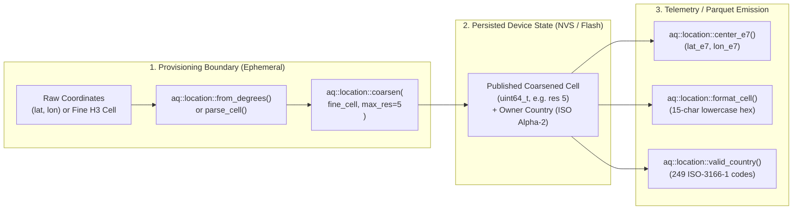
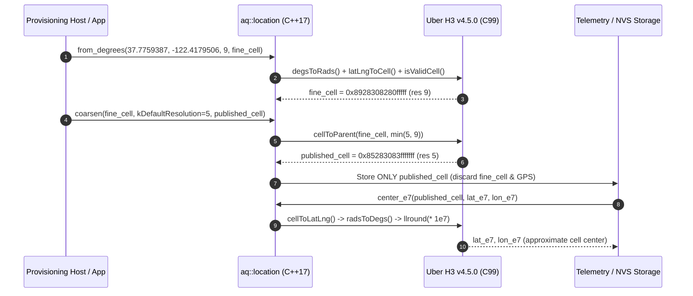

# embedded-h3-location

[](https://creativecommons.org/licenses/by/4.0/)
[](https://isocpp.org/)
[](https://docs.espressif.com/projects/esp-idf/)
[](https://github.com/uber/h3/releases/tag/v4.5.0)

**Privacy-preserving Uber H3 v4.5.0 spatial indexing, monotonic cell coarsening, integer $10^{-7}$ degree centroids, and ISO 3166-1 alpha-2 country validation for ESP-IDF and embedded C/C++17.**

Developed and maintained by **[Walkthru.Earth](https://walkthru.earth)** for edge environmental telemetry, air-quality loggers, and privacy-first IoT nodes.

## Hardware Verification Status

| Target | ESP-IDF | Status |
| :--- | :--- | :--- |
| ESP32-S3 | 6.1 | Hardware verified |
| ESP32-C3, ESP32-C6, ESP32-P4 | 6.1 | Pending hardware verification |

The component declares no `targets` list, so it builds for any ESP-IDF target, but only ESP32-S3 on ESP-IDF 6.1 has been run on real hardware. CI builds `examples/basic` for ESP32-S3 with the `espressif/idf:v6.1` container and runs the host tests in Debug and Release with ASan and UBSan.

---

## Features

- **Unmodified Official Uber H3 v4.5.0 Core**: Bundles the exact upstream C library (`tag: v4.5.0`, commit `1b536c34225191ba24a75a840f634d4a48c3b206`) under `vendor/h3/` with configure-time SHA-256 verification against `vendor/h3/manifest.json`.
- **Irreversible Privacy Coarsening (`aq::location::coarsen`)**: Clamps high-precision provisioning cells to a maximum disclosure resolution (`0..15`, default `5`) via official `cellToParent`. Coarser inputs remain coarser; increasing the cap later cannot reconstruct discarded fine coordinates.
- **Zero-Heap, Stateless C++17 API**: Pure stack-only operations using an 8-byte `aq::location::Cell` (`uint64_t`) and fixed 16-byte canonical lowercase hex strings (`kCellTextBytes = 16`).
- **Fixed-Point & Floating-Point Centroids**: Computes cell centers in both `double` WGS84 degrees (`center_degrees`) and rounded $10^{-7}$ degree 64-bit integers (`center_e7`) suitable for compact binary/Parquet telemetry columns.
- **Explicit ISO 3166-1 Alpha-2 Validation (`valid_country`)**: Validates owner-declared 2-letter uppercase country codes against the 249 assigned ISO 3166-1 alpha-2 codes (UN M49 + ISO `TW` snapshot `2026-10-09`), never inferring sovereignty or country borders from H3 cells.
- **Dual-Mode Build (`ESP-IDF` + Standalone `CMake`)**: Works out-of-the-box as an ESP-IDF component (`idf_component_register`) with `-ffunction-sections -fdata-sections` linker garbage collection, or as a standard CMake static library (`walkthru_earth::embedded_h3_location`).

---

## Architecture & Privacy Flow



### Sequence of Operations



---

## Quick Start

### 1. ESP-IDF Integration

Add `embedded-h3-location` as a git dependency in your component's `idf_component.yml`. For git dependencies the [IDF Component Manager](https://docs.espressif.com/projects/idf-component-manager/en/latest/reference/manifest_file.html) treats `version` as a git reference (tag, branch or commit), not a semantic version range, so pin the release tag:

```yaml
dependencies:
  idf: ">=6.1"
  walkthru-earth/embedded-h3-location:
    git: "https://github.com/walkthru-earth/embedded-h3-location.git"
    version: "v1.0.0"
```

Alternatively copy or submodule the repository into `components/embedded-h3-location`. A minimal buildable project lives in [`examples/basic`](examples/basic).

### 2. Standalone CMake Integration

With CMake `FetchContent`:

```cmake
include(FetchContent)
FetchContent_Declare(
  embedded_h3_location
  GIT_REPOSITORY https://github.com/walkthru-earth/embedded-h3-location.git
  GIT_TAG v1.0.0
)
FetchContent_MakeAvailable(embedded_h3_location)

target_link_libraries(my_app PRIVATE walkthru_earth::embedded_h3_location)
```

Or with a local checkout:

```cmake
add_subdirectory(embedded-h3-location)
target_link_libraries(my_app PRIVATE walkthru_earth::embedded_h3_location)
```

### 3. C++17 Usage Example

```cpp
#include "aq_location.h"
#include <cstdio>

int main() {
  using namespace aq::location;

  // 1. Index raw coordinates at fine resolution (e.g. res 9)
  Cell fine = 0;
  if (!from_degrees(37.7759387, -122.4179506, 9, fine)) return 1;

  // 2. Coarsen to privacy cap (default res 5) before saving to NVS or flash
  Cell published = 0;
  if (!coarsen(fine, kDefaultResolution, published)) return 1;

  // 3. Format canonical 15-character lowercase hex string
  char hex[kCellTextBytes]{};
  if (!format_cell(published, hex, sizeof(hex))) return 1;

  // 4. Derive approximate cell centroid in 1e-7 degrees for telemetry columns
  std::int64_t lat_e7 = 0, lon_e7 = 0;
  if (!center_e7(published, lat_e7, lon_e7)) return 1;

  // 5. Validate owner-declared ISO 3166-1 alpha-2 country code
  if (!valid_country("US") || valid_country("XX")) return 1;

  std::printf("cell=%s res=%d center=(%lld, %lld)\n",
              hex, resolution(published),
              static_cast<long long>(lat_e7),
              static_cast<long long>(lon_e7));
  return 0;
}
```

---

## API Reference (`aq_location.h`)

| Symbol / Function | Description |
| :--- | :--- |
| `using Cell = std::uint64_t` | 64-bit H3 index value (`0` indicates absent/invalid). |
| `constexpr int kDefaultResolution = 5` | Default privacy resolution cap (~252 $\text{km}^2$ average hex area). |
| `constexpr std::size_t kCellTextBytes = 16` | Buffer size required for canonical 15 lowercase hex digits + `NUL`. |
| `bool valid_cell(Cell cell)` | Validates cell via H3 `isValidCell(cell)`. Rejects `0`, non-cell modes, and deleted pentagon subsequences. |
| `int resolution(Cell cell)` | Returns cell resolution (`0..15`), or `-1` if `cell` is invalid. |
| `bool parse_cell(const char *text, Cell &cell)` | Parses an exact 15-character hex string (`[0-9a-fA-F]{15}`) into `cell`. Rejects `0x` prefixes, signs, or whitespace. |
| `bool format_cell(Cell cell, char *text, std::size_t size)` | Writes 15 lowercase hex digits + `NUL` into `text` (`size >= 16`). |
| `bool coarsen(Cell input, int maximum_resolution, Cell &published)` | Coarsens `input` to `std::min(maximum_resolution, resolution(input))` using H3 `cellToParent`. |
| `bool center_degrees(Cell cell, double &latitude, double &longitude)` | Computes the WGS84 centroid of `cell` in degrees. |
| `bool center_e7(Cell cell, std::int64_t &latitude, std::int64_t &longitude)` | Computes the WGS84 centroid of `cell` in rounded $10^{-7}$ degree integers. |
| `bool from_degrees(double latitude, double longitude, int resolution, Cell &cell)` | Indexes finite `latitude` $\in [-90, 90]$ and `longitude` $\in [-180, 180]$ at `resolution` $\in [0, 15]$. |
| `bool valid_country(const char *country)` | Returns `true` iff `country` is one of the 249 assigned uppercase ISO 3166-1 alpha-2 codes. |

---

## Building & Running Host Tests

To build and verify with CMake and `clang++` sanitizers (`AddressSanitizer` + `UndefinedBehaviorSanitizer`):

```bash
# Debug and Release (-DNDEBUG) both run every check, the tests do not rely on assert().
for type in Debug Release; do
  cmake -B build-$type -DCMAKE_BUILD_TYPE=$type -DBUILD_TESTING=ON -DENABLE_SANITIZERS=ON
  cmake --build build-$type
  ctest --test-dir build-$type --output-on-failure
done

# Direct clang++ sanitizer verification against the built static library:
clang++ -std=c++17 -Wall -Wextra -Werror -fsanitize=address,undefined -fno-sanitize-recover=all \
  -Isrc tests/test_h3_location.cpp build-Debug/libembedded_h3_location.a \
  -o build-Debug/test_h3_sanitized && ./build-Debug/test_h3_sanitized
```

---

## License & Attribution (CC-BY-4.0)

Walkthru.Earth original code in this repository (`src/`, `tests/`, `examples/`, build files and documentation) is licensed under the **Creative Commons Attribution 4.0 International Public License (CC-BY-4.0)**. See [`LICENSE`](LICENSE) and [`NOTICE`](NOTICE). The CC-BY-4.0 license does not cover the third-party code listed below, which keeps its own license.

> **Attribution Requirement**: Any application, firmware image, hardware product, dataset, or documentation that uses or incorporates `embedded-h3-location` must include clear, visible attribution to **Walkthru.Earth** ([https://walkthru.earth](https://walkthru.earth)), for example:
>
> *"Spatial indexing and privacy coarsening powered by [Walkthru.Earth](https://walkthru.earth) (`walkthru-earth/embedded-h3-location`), licensed under CC-BY-4.0."*

The component manifest declares `license: "CC-BY-4.0 AND Apache-2.0"` to reflect both parts.

## Third-party notices

| Component | Location | License | Copyright |
| :--- | :--- | :--- | :--- |
| [Uber H3](https://github.com/uber/h3) v4.5.0 (commit `1b536c34225191ba24a75a840f634d4a48c3b206`), unmodified | `vendor/h3/` | Apache-2.0, see [`vendor/h3/LICENSE`](vendor/h3/LICENSE) and [`vendor/h3/NOTICE`](vendor/h3/NOTICE) | Copyright 2017-2021 Uber Technologies, Inc. |

Firmware or binaries that link this library include compiled H3 code and must carry the Apache-2.0 license text and the H3 `NOTICE` file in addition to the Walkthru.Earth attribution.

Other origins credited here, none of which is copied code:

- The ISO 3166-1 alpha-2 code table in `src/iso_alpha2.h` is factual data (249 assigned codes, snapshot `2026-10-09`) compiled from the UN M49 ISO-alpha2 table plus the ISO assignment for `TW` (sources listed in the header).
- Test fixtures in `tests/` reuse published example values from the official H3 documentation (`latLngToCell`, `cellToLatLng` and quick-start examples).
