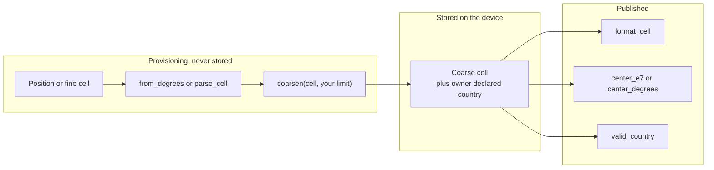
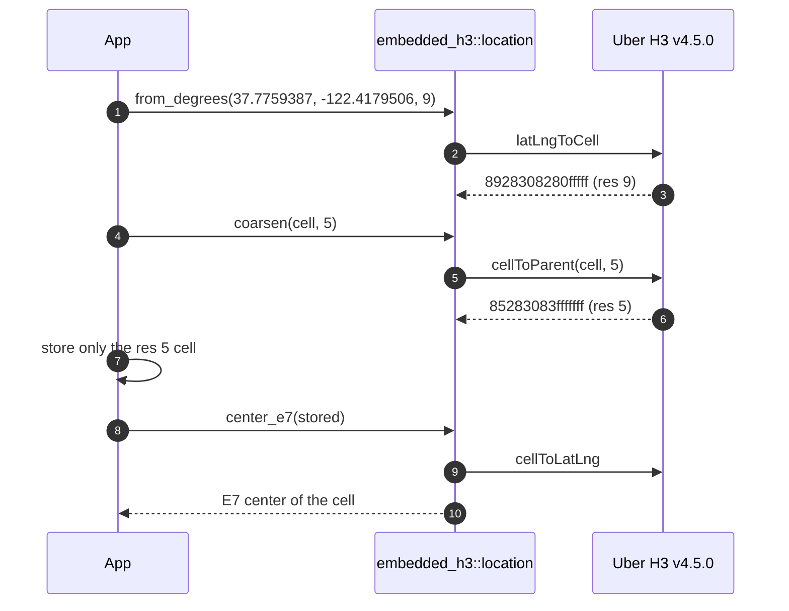

# embedded-h3-location

[](https://creativecommons.org/licenses/by/4.0/)
[](https://isocpp.org/)
[](https://docs.espressif.com/projects/esp-idf/)
[](https://github.com/uber/h3/releases/tag/v4.5.0)

A small C++23 layer over the official [Uber H3](https://github.com/uber/h3) C library for ESP-IDF and host builds. It indexes a position, coarsens a cell to a resolution the caller picks, prints and parses cell text, gives cell centers in degrees or $10^{-7}$ degrees, and checks ISO 3166-1 alpha-2 codes. Every fallible call returns `std::expected`. Nothing allocates, throws or keeps state.

Built and maintained by **[Walkthru.Earth](https://walkthru.earth)** for privacy first environmental sensors.

## Verification status

| Target | ESP-IDF | Status |
| :--- | :--- | :--- |
| ESP32-S3 | 6.1 (commit `fff9895c`) | The only verified target. v1.0.0 was verified on hardware. v2.0.0 builds in CI and has not run on a board yet |
| Any other chip | | Not verified and not claimed |

The manifest has no `targets` list, so other chips are not blocked. Only ESP32-S3 on ESP-IDF 6.1 is verified. CI builds `examples/basic` for ESP32-S3 in the `espressif/idf:v6.1` image pinned by digest, and runs the host tests in Debug and Release with ASan and UBSan.

| Toolchain | Where it ran |
| :--- | :--- |
| GCC 15.2.0 (`esp-15.2.0_20251204`), `-std=gnu++23` | ESP-IDF 6.1 example build, local and CI |
| GCC 14, `-std=c++23` | CI host tests and mutation proof on Ubuntu 24.04 |
| Clang 23 with libc++, `-std=c++23` | Local host tests on macOS |

The header needs `__cpp_lib_expected >= 202211L`, the C++23 `std::expected` with monadic operations such as `transform` and `and_then`. libstdc++ defines that value from GCC 13 and libc++ from LLVM 17. GCC 12 defines only `202202L` and stops at the `#error` in the header. GCC 13 and LLVM 17 were not run here, the table above lists what did run.

## What the library does



- **Coarsening is one way.** `coarsen()` returns the parent at `min(limit, resolution(cell))`. A coarser input comes back as it is, so raising the limit later never recovers finer location.
- **Fixed resolution storage.** `parent_at(cell, n)` returns the parent at exactly resolution `n`. A cell already at `n` comes back as it is. A coarser cell gives `Error::TooCoarse` and is never refined. Use it when every stored cell must sit at one resolution, for example the OpenSensor firmware rule of H3 res 8, which stays in the firmware.
- **The limit is yours.** The library has no default resolution. A consumer such as the OpenSensor firmware sets its own rule, for example resolution 8.
- **Store only the coarse cell.** Derive any public coordinate from that cell. A cell center is not the original position.
- **The country is declared, not derived.** `valid_country()` checks the code against the 249 assigned ISO 3166-1 alpha-2 codes. H3 is not a country lookup.
- **Official H3, unmodified.** Uber H3 v4.5.0 lives in `vendor/h3/`. CMake checks the SHA-256 of every file listed in `vendor/h3/manifest.json` and stops when `vendor/h3/` holds a file the manifest does not list, apart from macOS `.DS_Store`.



## Add it to a project

### ESP-IDF

For a git dependency the [IDF Component Manager](https://docs.espressif.com/projects/idf-component-manager/en/latest/reference/manifest_file.html) reads `version` as a git ref, a tag, branch or commit, not a version range. Pin the release tag.

```yaml
dependencies:
  idf: ">=6.1"
  walkthru-earth/embedded-h3-location:
    git: "https://github.com/walkthru-earth/embedded-h3-location.git"
    version: "v2.0.0"
```

ESP-IDF 6.1 compiles C++ as `gnu++26` by default. That is fine for the public header. This component compiles its own source as `gnu++23`, so an SDK default change cannot move its dialect. [`examples/basic`](examples/basic) is a minimal project.

### CMake

```cmake
include(FetchContent)
FetchContent_Declare(
  embedded_h3_location
  GIT_REPOSITORY https://github.com/walkthru-earth/embedded-h3-location.git
  GIT_TAG v2.0.0
)
FetchContent_MakeAvailable(embedded_h3_location)
target_link_libraries(my_app PRIVATE walkthru_earth::embedded_h3_location)
```

`add_subdirectory(embedded-h3-location)` works the same way for a local checkout. The target requires C++23 and passes that to your code.

## Usage

```cpp
#include <array>
#include <cinttypes>
#include <cstdio>

#include <embedded_h3/location.h>

namespace loc = embedded_h3::location;

// Your privacy rule. The library has no default.
constexpr int kPublishResolution = 8;

int main() {
  const auto published =
      loc::from_degrees(37.7759387, -122.4179506, 9)
          .and_then([](loc::Cell fine) { return loc::coarsen(fine, kPublishResolution); });
  if (!published) {
    std::printf("location failed: %s\n", loc::error_name(published.error()));
    return 1;
  }

  std::array<char, loc::kCellTextBytes> text{};
  if (!loc::format_cell(*published, text)) return 1;

  const auto center = loc::center_e7(*published);
  if (!center) return 1;

  std::printf("cell=%s res=%d center_e7=(%" PRId64 ", %" PRId64 ")\n", text.data(),
              loc::resolution(*published).value_or(-1), center->latitude,
              center->longitude);
  return loc::valid_country("US") ? 0 : 1;
}
```

Never call `.value()` on a result. Under `-fno-exceptions` it aborts on the device. Test the result, then use `*`, `->` or `value_or()`.

## API

Everything is in `namespace embedded_h3::location`, header `<embedded_h3/location.h>`. Every function is `noexcept` and `[[nodiscard]]`.

| Function | Returns | Errors |
| :--- | :--- | :--- |
| `valid_cell(Cell)` | `bool`, true for a valid H3 cell | |
| `resolution(Cell)` | `expected<int, Error>`, 0..15 | `InvalidCell` |
| `parse_cell(std::string_view)` | `expected<Cell, Error>` from exactly 15 hex digits, either case | `InvalidText`, `InvalidCell` |
| `format_cell(Cell, std::span<char, 16>)` | `expected<void, Error>`, 15 lowercase digits and a NUL | `InvalidCell` |
| `coarsen(Cell, int maximum_resolution)` | `expected<Cell, Error>`, parent at `min(limit, resolution)` | `InvalidResolution`, then `InvalidCell` |
| `parent_at(Cell, int resolution)` | `expected<Cell, Error>`, parent at exactly that resolution, never a child | `InvalidResolution`, then `InvalidCell`, then `TooCoarse` |
| `center_degrees(Cell)` | `expected<Degrees, Error>` | `InvalidCell` |
| `center_e7(Cell)` | `expected<E7, Error>`, degrees times $10^7$, half away from zero | `InvalidCell` |
| `from_degrees(double lat, double lng, int resolution)` | `expected<Cell, Error>` | `NonFinite`, then `OutOfRange`, then `InvalidResolution` |
| `valid_country(std::string_view)` | `bool`, true for one of 249 uppercase codes | |
| `error_name(Error)` | `const char *`, such as `"invalid_cell"`, safe for `%s` | |

| `Error` | Meaning |
| :--- | :--- |
| `InvalidCell` | Not a valid H3 cell, including the absent cell 0 |
| `InvalidResolution` | Resolution outside 0..15 |
| `OutOfRange` | Latitude outside -90..90 or longitude outside -180..180, both ends allowed |
| `NonFinite` | Latitude or longitude is NaN or infinite |
| `InvalidText` | Cell text is not exactly 15 hex digits |
| `H3Failure` | H3 rejected input this library had already checked |
| `TooCoarse` | `parent_at` got a cell coarser than the resolution it asks for |

A `format_cell` buffer shorter than 16 bytes does not compile. A `std::string_view` does not need a NUL terminator.

## Migrating from v1

v2 breaks the v1 API on purpose. There are no aliases.

| v1 | v2 |
| :--- | :--- |
| `#include "aq_location.h"` | `#include <embedded_h3/location.h>` |
| `namespace aq::location` | `namespace embedded_h3::location` |
| C++17 | C++23 for the library and for any file that includes the header. ESP-IDF 6.1 `gnu++26` works |
| `bool f(..., T &out)` | `std::expected<T, Error> f(...)` |
| `kDefaultResolution = 5` | Removed. Pass your own limit to `coarsen()` |
| `resolution()` returns -1 when invalid | Returns `Error::InvalidCell` |
| `parse_cell(const char *, Cell &)` | `parse_cell(std::string_view)` |
| `format_cell(Cell, char *, size_t)` | `format_cell(Cell, std::span<char, 16>)` |
| `center_e7(Cell, int64_t &, int64_t &)` | `center_e7(Cell)` returns `E7{latitude, longitude}` |
| `valid_country(const char *)` | `valid_country(std::string_view)` |
| none | `parent_at(Cell, int)` for one fixed resolution. A firmware `published_cell(cell)` with `kPublishedResolution = 8` becomes `parent_at(cell, 8)`, with `Invalid` mapping to `InvalidCell` and `TooCoarse` to `TooCoarse` |

The CMake target `walkthru_earth::embedded_h3_location` and the component name `walkthru-earth/embedded-h3-location` stay the same. Cell values, cell text and center values are the same for the same input, because H3 and the rounding did not change.

## Reproducible images

H3 calls `assert()`, which expands `__FILE__`, and debug info names source paths. With `EMBEDDED_H3_LOCATION_MAP_PATHS` on, the default, CMake adds `-ffile-prefix-map` so this checkout becomes `embedded-h3-location` and its build directory becomes `embedded-h3-location-build`. The checkout map is public, because your debug info names the header directory. Turn it off with `-DEMBEDDED_H3_LOCATION_MAP_PATHS=OFF` if you map paths yourself. Our own code never uses `__FILE__`.

Evidence on 2026-11-09 with ESP-IDF 6.1 for ESP32-S3.

- With `CONFIG_APP_REPRODUCIBLE_BUILD=y`, `examples/basic` built from two checkout paths gave the same app image, SHA-256 `9e010c6ffa9cabb568a0081ca183e43756e0059cda58128ae49256750ea7760b`. Neither `.bin` nor `.elf` held the checkout path.
- Without that option, the map alone left no checkout path in the `.bin` or the `.elf`.
- With the map off, the `.bin` held the absolute path of `vendor/h3/h3lib/lib/h3Index.c` from an H3 assert.

CI repeats the two path build on every pull request. The IDF Component Manager finds an `override_path` component by its directory name, so keep the checkout folder named `embedded-h3-location`.

## Develop

```bash
cmake --preset dev        # Debug, ASan and UBSan, writes build/compile_commands.json
cmake --build --preset dev
ctest --preset dev
cmake --preset release && cmake --build --preset release && ctest --preset release
tools/mutation_test.sh    # every guard mutant must be killed
tools/check_h3_release.sh # warns when uber/h3 has a newer release
```

**Editor support.** The committed [`.clangd`](.clangd) reads `build/compile_commands.json`, so run `cmake --preset dev` once. Before that, a fallback gives clangd `-std=c++23` with `include/` and `src/` on the path. `h3api.h` is generated by CMake, so files that include it need the configure step.

The tests cover every `Error` value, every H3 error code mapping, the resolution and coordinate bounds, pentagons, invalid cells, coarsening monotonicity and `parent_at` against H3 `cellToParent` for every input and target resolution. `tools/mutation_test.sh` breaks each guard in `src/location.cpp` one at a time and checks that the tests fail. Maintainer rules and the H3 upgrade steps are in [`AGENTS.md`](AGENTS.md).

## Upstream H3 fixes not yet released

The newest uber/h3 release is v4.5.0, so that is what we vendor. We never vendor `master`. The upstream changelog lists these fixes under Unreleased, checked on 2026-11-09 at master `f421dc84`.

| Fix | Upstream | Effect here |
| :--- | :--- | :--- |
| Latitude precision near the poles in `cellToLatLng` and `cellToBoundary` | [#1255](https://github.com/uber/h3/pull/1255) | `center_degrees` and `center_e7` call `cellToLatLng`, so centers near the poles get the fix after the next release. We have not measured the size of the change |
| Out of bounds write in `gridRing` with a negative `k` | [#1235](https://github.com/uber/h3/pull/1235) | Our API never calls `gridRing` |
| Out of bounds read in `_baseCellToCCWrot60` when `face == NUM_ICOSA_FACES` | [#1224](https://github.com/uber/h3/pull/1224) | Only the vertex functions call it, and our API does not |
| `dirFaces` initialized in `vertexRotations` | [#1273](https://github.com/uber/h3/pull/1273) | A compiler warning fix in vertex code we do not call |

`tools/check_h3_release.sh` runs in CI on every pull request and fails the weekly scheduled run once a newer release exists. On a pull request it only warns, also when GitHub cannot be reached. The weekly run fails in both cases.

## License and attribution

Walkthru.Earth code in this repository (`include/`, `src/`, `tests/`, `tools/`, `examples/`, build files and docs) is licensed under the **Creative Commons Attribution 4.0 International Public License (CC-BY-4.0)**. See [`LICENSE`](LICENSE) and [`NOTICE`](NOTICE). CC-BY-4.0 does not cover the third-party code below.

> **Attribution.** Any application, firmware image, product, dataset or document that uses `embedded-h3-location` must credit **Walkthru.Earth** ([https://walkthru.earth](https://walkthru.earth)) in a visible place. For example
>
> *"Spatial indexing and privacy coarsening by [Walkthru.Earth](https://walkthru.earth) (`walkthru-earth/embedded-h3-location`), licensed under CC-BY-4.0."*

The component manifest declares `license: "CC-BY-4.0 AND Apache-2.0"` for both parts. The [manifest reference](https://docs.espressif.com/projects/idf-component-manager/en/latest/reference/manifest_file.html#license) asks for an SPDX license identifier, and this value is an SPDX expression. The registry accepts expressions in practice. Espressif's own `espressif/quickjs-ng` 0.14.0 declares `license: MIT AND Apache-2.0` in its `idf_component.yml`, and the registry API lists it with that name, checked on 2026-11-09. `vendor/h3/` keeps Apache-2.0 with its own `LICENSE` and `NOTICE` either way.

### Third-party notices

| Component | Location | License | Copyright |
| :--- | :--- | :--- | :--- |
| [Uber H3](https://github.com/uber/h3) v4.5.0, commit `1b536c34225191ba24a75a840f634d4a48c3b206`, unmodified | `vendor/h3/` | Apache-2.0, see [`vendor/h3/LICENSE`](vendor/h3/LICENSE) and [`vendor/h3/NOTICE`](vendor/h3/NOTICE) | Copyright 2017-2021 Uber Technologies, Inc. |

A firmware image or binary that links this library contains compiled H3 code. Ship the Apache-2.0 license text and the H3 `NOTICE` file with it, next to the Walkthru.Earth attribution.

Other credits, none of them copied code.

- The ISO 3166-1 alpha-2 table in `src/iso_alpha2.h` is factual data, 249 assigned codes from a 2026-10-09 snapshot of the UN M49 ISO-alpha2 table plus the ISO assignment for `TW`. Sources are listed in the header.
- Test fixtures in `tests/` reuse example values from the official H3 documentation.
